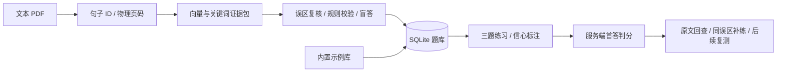

# 知证学伴

知证学伴是一款面向讲义学习的 AI 教育应用，将原文阅读、知识点练习、误区分析和定向补练串成完整的学习流程。每道题关联讲义中的证据句，学习者可以在作答后对照原文理解答案，并通过后续复测观察误区纠正进展。

[公开代码仓库](https://github.com/rbtrenbingtan/AI-WEB) · [下载参赛材料](https://github.com/rbtrenbingtan/AI-WEB/releases) · [环境配置指南](docs/environment.md) · [架构说明](docs/architecture.md)

## 项目介绍

项目围绕“找到依据、识别误区、针对练习”设计，提供资料、练习、复习和 AI 工作台四个页面。

| 功能 | 实现内容 |
| --- | --- |
| 资料管理 | 导入文本型 PDF，提取物理页码与句子 ID，确认候选知识点，查看知识点和误区的题库覆盖情况 |
| 三题练习 | 按知识点组卷，作答时主动选择信心等级，由服务端判分并保存首次提交结果 |
| 原文对照 | 桌面端并列展示题目与原文，手机端通过底部面板查看证据；每个选项都有对应解析 |
| 定向补练 | 根据选错的干扰项定位具体误区，选取相关题继续练习；实时模式下可补充生成题目 |
| 复习复测 | 按高信心错误优先整理复习任务，展示待纠正、纠正中和近期已纠正状态，并在后续轮次混入复测 |
| AI 工作台 | 展示句级锚定、混合检索、误区建模、约束出题、复核修复与学习闭环六个阶段，查看资料片段、误区和调用记录 |

练习支持 A–D / 1–4 选项快捷键、Enter 提交和刷新恢复。复习页汇总知识点答题表现、信心与对错分布；“近期已纠正”要求上次错误后，在至少两道不同的相关题上答对。

## 技术架构

| 层次 | 技术与职责 |
| --- | --- |
| 前端 | React、Vite、TypeScript、Lucide；实现四页学习界面、响应式布局和本地状态恢复 |
| 后端 | FastAPI、Pydantic、asyncio；提供 API、会话隔离、服务端判分和后台生成任务 |
| 数据存储 | SQLite 保存资料、句子、误区、题库、答题和任务记录；独立数据目录保存上传 PDF 与向量缓存 |
| 文档解析 | pypdf 在独立子进程中提取文本，保留物理页码、句子 ID 和片段索引 |
| AI 服务 | 通过 OpenAI 兼容文本与向量接口完成知识点提取、证据检索、误区生成、出题及独立复核 |
| 部署 | FastAPI 同源提供静态页面与 API；Docker 采用单容器、单 worker 和持久化数据卷 |



检索采用向量 Top-4 与关键词补充的并集，并将误区纠正句纳入证据包。生成结果经过结构、引用和选项校验，再由独立复核流程检查原文依据、答案唯一性和干扰项的误区映射，通过后写入实时题库。证据引文由后端根据句子 ID 回填。

后台任务通过 asyncio 控制并发，记录调用日志、次数预算和重试状态，支持重启后的任务状态恢复与继续生成。详细设计见 [架构说明](docs/architecture.md)。

## 安装运行指南

### 环境要求

- Git。
- Python 3.11 及以上。
- Node.js 22.x（至少 22.12.0）或 24.x，配套 npm；`.nvmrc` 指定 22 系列。

Python 依赖由 `requirements.txt` 列出，并通过 `requirements-lock.txt` 固定版本；前端依赖由 `frontend/package.json` 和 `frontend/package-lock.json` 管理。完整手动安装步骤和变量说明见 [环境配置指南](docs/environment.md)。

### 获取源码

```bash
git clone https://github.com/rbtrenbingtan/AI-WEB.git
cd AI-WEB
```

后续命令均在项目根目录执行。项目内置离线示例库，启动后即可体验完整的示例学习流程。

### Windows

```powershell
powershell -ExecutionPolicy Bypass -File .\scripts\start.ps1 -Install
```

脚本创建虚拟环境、安装锁定依赖、构建前端并启动应用。之后可运行 `powershell -ExecutionPolicy Bypass -File .\scripts\start.ps1`。

### macOS / Linux

```bash
sh scripts/start.sh
```

打开 <http://127.0.0.1:8000>，API 文档位于 <http://127.0.0.1:8000/docs>。按 Ctrl+C 停止。

自定义端口：Windows 为启动脚本追加 `-Port 8765`；macOS / Linux 使用 `PORT=8765 sh scripts/start.sh`。

### Docker

```bash
docker compose up --build -d
```

访问 <http://127.0.0.1:8000>。`study-data` 卷持久化保存 SQLite、上传 PDF 和向量缓存。Compose 配置支持可选 `.env` 文件；使用支持 `env_file.required` 的 Docker Compose 版本。旧版 Compose 可先复制 `.env.example` 为 `.env`，再使用普通 `env_file: .env` 配置。

## AI 服务配置

项目提供内置示例模式和模型服务实时模式。复制 `.env.example` 为 `.env`，填写服务端参数后重启应用，即可接入实时生成流程：

```dotenv
LLM_API_KEY=你的模型服务密钥
LLM_BASE_URL=https://你的兼容服务/v1
LLM_MODEL=该服务支持的文本模型
REVIEW_MODEL=该服务支持的复核模型
EMBED_BASE_URL=https://你的向量服务/v1
EMBED_MODEL=该服务支持的向量模型
LLM_TIMEOUT_SECONDS=45
```

文本接口需支持 Chat Completions 和 `response_format: json_object`，向量接口使用 embeddings。独立向量服务可配置 `EMBED_API_KEY`，独立复核服务可配置 `REVIEW_BASE_URL` / `REVIEW_API_KEY`；密钥由后端读取。

模板同时提供数据目录、生成并发、单资料及每日调用预算、上传开关和 Cookie 配置。各项默认值与回退规则见 [环境变量说明](docs/environment.md#环境变量)。

实时学习流程：上传文本型 PDF → 查看抽取样本 → 确认知识点 → 建立证据包 → 生成误区与题库 → 开始练习。单份资料支持 10 MB 以内、30 页以内的文本型 PDF；知识点积累 3 道题后即可开始练习。

配置检查（macOS / Linux）：

```bash
.venv/bin/python scripts/check_provider.py
.venv/bin/python scripts/check_provider.py --live
```

Windows 将 `.venv/bin/python` 替换为 `.\.venv\Scripts\python.exe`。默认命令检查本地配置；增加 `--live` 后调用生成、复核和向量接口，记录连接状态、时延与服务用量，报告保存到 `data/provider-checks/`。在线检查按供应商计费规则产生相应服务用量。

## 示例资料

项目内置 8 页原创演示讲义、4 个知识点、12 个误区和 48 道题。

- `examples/source_notes.md`：按物理页面组织的讲义源文件。
- `examples/sample_notes.pdf`：配套 PDF 讲义。
- `seed/demo.sqlite`：离线示例数据库，首次启动时复制到数据目录。

重新构建示例题库：

```bash
.venv/bin/python scripts/build_seed.py --force
.venv/bin/python scripts/build_pdf.py
```

实时模式生成的题目可导出为新的离线资料库：

```bash
.venv/bin/python scripts/build_seed.py --source-db data/app.sqlite --document-id 实际文档ID --output seed/reviewed.sqlite
```

导出内容包含指定资料及通过盲答复核的题目。示例模式与实时模式在界面中显示对应的内容来源。

## 开发与测试

macOS / Linux 启动后端开发服务：

```bash
.venv/bin/python -m uvicorn backend.main:app --reload --port 8000
```

Windows 使用 `.\.venv\Scripts\python.exe` 执行相同参数。另开终端启动前端：

```bash
npm --prefix frontend ci
npm --prefix frontend run dev
```

前端开发地址为 <http://127.0.0.1:5173>，通过 Vite 代理调用后端 API。

执行检查：

```bash
.venv/bin/python -m pytest
npm --prefix frontend test
npm --prefix frontend run build
```

2026-11-17 验证结果：**81 项后端测试、15 项前端测试通过**，TypeScript 检查及 Vite 生产构建通过，锁定依赖安装成功。后端测试覆盖 PDF 解析、会话隔离、首答判分、误区补练、复测状态、生成校验、预算控制和资源保护；前端测试覆盖交互、状态恢复和工作台展示。

界面已完成 1440×900 桌面与 390×844 手机视口的学习流程检查。验证环境和详细记录见 [工程与界面验证](docs/verification.md) 与 [前端验收](docs/frontend-acceptance.md)。

## 项目结构

```text
frontend/             React + TypeScript 学习界面与 AI 工作台
backend/main.py       API、会话、后台任务和学习逻辑
backend/db.py         SQLite 表结构
backend/seed_data.py  示例讲义和题库
backend/ai/           PDF 解析、检索、模型调用与质量校验
backend/prompts/      版本化提示词
scripts/             启动、种子构建、PDF 生成和指标导出
seed/                离线示例数据库
examples/            示例讲义
tests/              自动化工程测试
eval/               评测表与指标记录
docs/               架构、配置、验证记录和界面截图
tools/submission/   技术文档、视频生成与材料检查工具
```

## 交付材料与开发历史

[GitHub Releases](https://github.com/rbtrenbingtan/AI-WEB/releases) 提供完整下载包及单独附件：

| 材料 | 内容 |
| --- | --- |
| 技术文档 PDF | 17 页，介绍项目需求、系统架构、AI 方案、功能实现、测试部署和创新设计 |
| 演示视频 MP4 | 7 分 27 秒，1920×1080，H.264 / AAC，结合实际页面截图、普通话合成解说与字幕展示学习流程 |
| 源码 ZIP | 运行源码、环境模板、依赖锁文件、示例库和配套文档 |
| Git bundle | 完整开发历史，支持离线恢复仓库 |
| 完整提交包 | 汇总 PDF、MP4、源码、历史包、检查报告和 SHA-256 校验清单 |

克隆仓库后执行 `git log --oneline --all` 查看完整提交历史。离线恢复使用：

```bash
git clone 知证学伴-完整历史.bundle zhizheng-study
```

材料生成与检查方法见 [材料工具说明](tools/submission/README.md)。

## 团队信息

| 项目 | 信息 |
| --- | --- |
| 团队名称 | 农农交交 |
| 团队编号 | 43768 |
| 所属院校 | 西安交通大学 |
| 参赛组别 | 研究生组 |
| 成功组队人数 | 3 |
| 剩余队员名额 | 0 |
