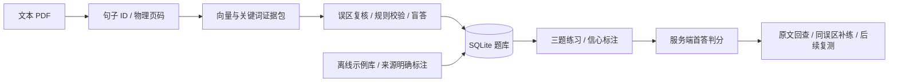

# 知证学伴

依据《知证学伴-方案V2》实现的 React + FastAPI 学习应用：选择讲义和知识点，作答并标注信心，回查原文证据，按所选错误选项对应的误区补练，再在后续练习中复测。

## 项目与交付范围

当前交付范围为本地源码与参赛材料整理。尚未发布远程代码仓库、部署公网应用或向赛事官网提交；本轮未配置或请求真实模型服务。示例学习流程无需 Key，实时接口的真实供应商验收需要后续单独完成。

## 团队信息

| 项目 | 信息 |
| --- | --- |
| 团队名称 | 农农交交 |
| 所在学校 | 西安交通大学 |
| 团队成员 | 龚子墨、倪梓翔、任炳锬 |
| 学历层次 | 硕士研究生 |
| 参赛组别 | 研究生组（按参赛规则，研究生只能报名研究生组） |

团队由 3 名同校学生组成。成员分工和指导老师信息尚未提供，不代填；如配备指导老师，按规则不超过 2 名。

## 参赛与提交

本作品选题为 **AI 教育与学习平台**，以证据检索、误区建模、生成复核和针对性练习为核心。根据本次提供的省赛规则，报名与作品提交截止日期均为 **2026 年 11 月 18 日**，原文未列具体截止钟点，以赛事系统显示为准。完成缴费后，登录赛事个人中心，在所报赛项查看作品提交入口，不等待单独的外部链接。

正式提交须提供 Public 或评审可访问的 GitHub/Gitee 代码仓库、5–8 分钟且不低于 1080p 的普通话 MP4 演示视频，以及不超过 30 页的技术 PDF。当前本地材料已准备，远程仓库和官网提交尚未完成；公网在线演示为可选加分项。完整核对表见 [本地提交审计](docs/submission-audit.md)。

## 技术架构

前端使用 React + Vite + TypeScript，提供资料、练习、复习和 AI 工作台四页。生产环境由 FastAPI 同源提供静态页面与 API，SQLite 保存文档、句子、误区、题库、答题和任务记录；上传 PDF 及向量缓存放在独立数据目录。Docker 采用单容器、单 worker，并通过持久卷保存数据。

导入时用 pypdf 在受限子进程中提取文本，保存物理页码和句子 ID；后台使用 OpenAI 兼容文本 / 向量接口建立证据包、生成误区与题目。程序校验结构、引用和选项，再独立复核原文能否反驳误区、题目是否唯一可答及干扰项的误区标注。通过后才写入实时题库；练习时从库存组卷，后端判分，前端在作答后才能取得答案与解释。



后台任务采用进程内 asyncio 并发控制，重启后标记中断并支持继续；不依赖 Redis、外部向量数据库或多智能体链路。详见 [架构说明](docs/architecture.md)。

## 快速运行

需要 Python 3.11+、Node.js 20.19+。所有命令在本目录执行。无 API Key 即可体验完整的示例学习闭环。

Windows PowerShell：

```powershell
powershell -ExecutionPolicy Bypass -File .\scripts\start.ps1 -Install
```

之后再次运行可省略 `-Install`。脚本只为这次执行设置策略，不修改系统执行策略。

Linux / macOS：

```bash
sh scripts/start.sh
```

打开 <http://127.0.0.1:8000>。API 文档位于 <http://127.0.0.1:8000/docs>。按 Ctrl+C 停止。

若 8000 端口被系统保留或占用，Windows 可追加 `-Port 8765`；Linux / macOS 可使用 `PORT=8765 sh scripts/start.sh`。本次环境已在 8765 端口完成浏览器验证。

## Docker

```bash
docker compose up --build -d
```

仍访问 8000 端口。`study-data` 卷保存 SQLite、上传 PDF 和向量缓存。使用单 worker，避免进程内后台任务被重复调度。可选 `.env` 需要支持 `env_file.required` 的 Docker Compose；旧版 Compose 可先复制 `.env.example` 为 `.env`，并改成普通 `env_file: .env`。

## 实时模式

复制 `.env.example` 为 `.env`，填写服务端参数并重启：

```dotenv
LLM_API_KEY=你的模型服务密钥
LLM_BASE_URL=https://你的兼容服务/v1
LLM_MODEL=该服务支持的文本模型
REVIEW_MODEL=该服务支持的复核模型
EMBED_BASE_URL=https://你的向量服务/v1
EMBED_MODEL=该服务支持的向量模型
```

独立向量供应商可配置 `EMBED_API_KEY`；独立复核供应商可配置 `REVIEW_BASE_URL` / `REVIEW_API_KEY`。接口使用 OpenAI 兼容 Chat Completions JSON 模式与 embeddings；服务须支持 `response_format: json_object`。密钥只保存在后端，不写入前端环境变量。

配置检查命令如下。**默认只读本地配置，不请求网络；只有显式增加 `--live` 才发送可能计费的真实请求。** 当前本地交付仅执行了默认检查，没有运行 `--live`。

```powershell
.\.venv\Scripts\python.exe scripts/check_provider.py
# 仅在自行配置凭证并决定进行真实验收后执行：
.\.venv\Scripts\python.exe scripts/check_provider.py --live
```

真实检查覆盖生成模型 JSON、复核模型 JSON 和向量接口，记录调用状态、时延及供应商返回的用量；报告默认存入 `data/provider-checks/`。它只证明连接和协议可用，不证明题目质量或教学效果。未返回用量的供应商不能据日志中的默认值认定为免费调用。

实时流程：上传文本型 PDF → 查看抽取样本 → 勾选、修改候选知识点 → 确认 → 后台建立证据包、生成误区和题库。达到 3 题的知识点可开始练习。模型失败、预算耗尽或重启会留下明确状态；资料页可继续生成。默认上传限制 10 MB / 30 页，不支持扫描 PDF / OCR。公开演示部署建议保持无 Key 模式。

## 已实现的学习行为

- **资料**：一键进入三题示例练习、候选知识点确认、知识点与误区覆盖度、后台处理状态；配置实时模式后可导入 PDF，后台保留物理页码及句子 ID。
- **练习**：三道未答题、目标误区不同、信心必须主动选择、服务端判分、首次提交唯一约束、刷新恢复。桌面作答后显示“题目 | 原文”对照，每个选项下方直接展开解析；手机使用底部原文面板。支持 A–D / 1–4 和 Enter 快捷键。
- **补练**：按选错的干扰项对应误区取未做过的题；实时模式下自有上传资料库存不足时生成，仍走相同质量检查。
- **复习**：高信心错误优先、待纠正 / 纠正中 / 近期已纠正、知识点答题汇总、信心与对错统计、猜对复查、下一轮自动混入复测。
- **AI 工作流**：向量 Top-4 与关键词补充并集、纠正句强制进入证据包、误区原文反驳复核、代码校验、随机选项映射、独立盲答与选项误区映射复核、最多一次修复、调用日志、预算与有限重试。
- **AI 工作台**：六个可展开的阶段展示句级锚定、混合 RAG、结构化误区、约束出题、复核修复与学习闭环；读取当前资料的已保存片段、误区和调用记录。示例资料明确标为“示例流程”，当前调用次数为 0，未配置的模型角色显示“待接入”。

状态仅描述观察到的答题表现；近期已纠正要求上次错误后在至少两道不同的相关题上答对。系统不输出未经验证的掌握度或提分承诺。

## 示例内容与真实性

`examples/source_notes.md` 是本项目原创演示讲义，按物理页面编排；`examples/sample_notes.pdf` 为其可打印版本。`seed/demo.sqlite` 随项目分发，首次启动复制到数据目录，无 Key 不需要外部服务。

重新构建离线题库：`python scripts/build_seed.py --force`。真实模型生成后，可使用 `python scripts/build_seed.py --source-db data/app.sqlite --document-id 实际文档ID --output seed/reviewed.sqlite` 导出该资料及通过盲答复核的题；不会导出会话、答题或调用日志。生成配套讲义：`python scripts/build_pdf.py`。离线演示直接使用证据包与题库，不附造假的模型向量缓存；真实导入产生的缓存保存在数据目录。

**示例内容由编码助手离线编写，并通过程序结构检查；尚未经过独立人工审定或真实模型盲答复核。** 前端和数据库保留此来源标记，不能把示例库描述为人工审定或线上生成结果。实时模式生成的题则必须通过代码校验和模型盲答才会入库。正式参赛前应由团队核对示例内容，记录审定人和修订事实。

证据句由后端按 ID 查表回填，不接受模型指定页码或引文。但“引文存在”不等于语义上必然支持答案，模型复核也不能替代人工评测。

## 开发与检查

```powershell
# 后端（另开终端；先安装依赖）
.\.venv\Scripts\python.exe -m uvicorn backend.main:app --reload --port 8000
# 前端
cd frontend
npm ci
npm run dev
```

前端开发地址 <http://127.0.0.1:5173>，通过 Vite 代理调用 API。生产构建由 FastAPI 同源提供。Python 实际环境锁定记录在 `requirements-lock.txt`，前端版本由 `package-lock.json` 锁定。

```powershell
.\.venv\Scripts\python.exe -m pytest
cd frontend
npm test
npm run build
```

```powershell
# 从真实运行数据库导出调用日志与汇总；不导出原文或会话 ID
.\.venv\Scripts\python.exe scripts/export_metrics.py --db data/app.sqlite
```

2026-11-17 本地验收：**73 项后端工程测试、15 项前端测试通过**，TypeScript 检查及 Vite 生产构建通过，`npm audit` 当次报告 0 个漏洞。浏览器在 1440×900 桌面和 390×844 手机视口完成学习闭环与 AI 工作台检查，未观察到横向溢出或控制台错误。详见 [实际验证结果](docs/verification.md) 和 [前端逐项验收](docs/frontend-acceptance.md)。无凭证时不能声称验证了真实供应商调用、真实生成质量或费用；测试中的模型替身只验证协议和流程。Docker 配置需在安装 Docker 的环境中进一步验证。

## 项目结构

```text
frontend/             React + TypeScript 四页应用，含 AI 工作台
backend/main.py       FastAPI 路由、会话、后台任务和学习逻辑
backend/db.py         SQLite 表结构
backend/seed_data.py  示例讲义和题库的可追溯内容
backend/ai/           PDF 解析、检索、模型调用与质量校验
backend/prompts/      版本化提示词
scripts/             启动、种子构建、PDF 生成和指标导出
seed/                无 Key 示例数据库
examples/            示例讲义
tests/               自动化工程测试
eval/                人工评测表与实际结果
docs/                架构、验收结果、报告内容、演示分镜及真实截图
tools/submission/    技术文档、视频生成及本地材料检查脚本
submission/          本地参赛材料输出目录（不纳入源码仓库）
```

会话通过 httpOnly Cookie 绑定当前浏览器；清除 Cookie 后无法再访问原会话记录。数据库中的旧记录不会自动物理删除。本项目按方案不提供完整账号系统、班级管理、OCR 或自由问答。

## 本地参赛材料与开发历史

本轮按以下文件组织本地提交包；各项生成与终检状态见 [本地提交审计](docs/submission-audit.md)，不能把目录规划当作已向赛事提交。

| 文件 | 用途 |
| --- | --- |
| `submission/知证学伴-技术文档.pdf` | 17 页技术说明，覆盖项目概述、需求、架构、AI 选型与优化、实现、测试部署、创新与展望 |
| `submission/知证学伴-演示视频.mp4` | 7 分 27 秒、1920×1080、H.264 / AAC 的 MP4；真实页面操作截图、普通话合成解说和字幕，非真人录屏或真实模型调用演示 |
| `submission/知证学伴-源码.zip` | 可运行源码、锁文件、环境模板和示例库，不包含凭证、用户数据或本地依赖目录 |
| `submission/知证学伴-完整历史.bundle` | 完整本地 Git 历史，用于审查真实开发记录；源码 ZIP 本身不保留 `.git` |

收到 bundle 后可用 `git clone 知证学伴-完整历史.bundle zhizheng-study` 恢复本地仓库，用 `git log --oneline --all` 查看提交历史。已有历史保留真实提交者信息，不把工具署名改写成成员本人操作记录。远程仓库地址需团队后续实际发布后填写。

材料生成流程见 [材料工具说明](tools/submission/README.md)。执行 `.\.venv\Scripts\python.exe tools/submission/check_package.py` 可复查 PDF 页数与章节、视频时长与音视频格式、源码 ZIP 清单及 bundle 完整性，结果写入 `submission/check-results.json`。正式上传前仍须核对最终文件内容与赛事通知。

## 尚待团队完成

正式提交仍需发布评审可访问的 GitHub/Gitee 仓库、确认报名缴费与研究生组选项，并在 2026 年 11 月 18 日截止前通过赛事个人中心提交全部材料。提交后不得擅自修改，特殊情况须联系组委会。

能力验证方面，真实模型服务端到端验收、独立内容审定、冻结测试集及留出资料评测、真人可用性测试尚未完成，未验证提分或长期学习效果；这些与材料格式检查分开记录。本轮仅更新本地材料。方案中的可选 P1（计算题模拟器 / 先找依据模式）未纳入这一版。
