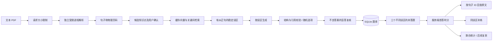

# 实现架构

浏览器运行 React + TypeScript；开发时由 Vite 代理 API，生产时构建静态文件由 FastAPI 同源提供。后端单进程运行，SQLite 负责持久化，asyncio 任务与信号量负责有界并发。没有外部队列或向量数据库。

## 数据约束

documents 包含归属与只读示例标记；pages 和 extraction_metadata 分别保存归一化展示文本及抽取原文、稀疏页面提示。上传 PDF 保留在私有数据目录，不由静态路由暴露。

sentences 保存稳定 ID、页码、页内偏移，chunks 不跨页；topics 与 misconceptions 保存证据包和纠正句引用。questions 保存后端完整答案、选项映射、提示词版本和模型。quizzes 保存会话组卷；attempts 的 `(session_id, question_id)` 唯一约束保证首答计分。

jobs 保存状态和进度；重启将排队和运行任务标为 interrupted，用户可继续。llm_calls 不包含提示词原文、模型响应原文或密钥；generation_runs 记录代码拒绝、复核拒绝、修复和入库计数。call_reservations 使用 SQLite 写事务，在请求模型前扣减文档和全局日预算（UTC 日界线）。失败重试也计费并记账。

## 访问和质量边界

httpOnly / SameSite Cookie 随机生成会话标识，所有资源查询检查归属。变更请求校验浏览器 Origin；上传在 multipart 解析前有大小限制，PDF 子进程受总超时和内存限制，再限制页数和单页文本长度。原文和模型内容在 React 中作为纯文本渲染。

未作答题只返回题干和选项，没有答案、反馈、目标误区或证据字段；作答必须属于本会话组卷。后端查表判分，返回所选干扰项对应的误区。展示引用从句子表读取，页码不是模型输出。

实时入库必须通过结构校验和独立调用的盲答复核。盲答只看到题干、选项文字及引用原文，不能看到预期答案；还必须确认依据充分且无其他合理答案。失败最多修复一次。示例库是明确标注的离线 AI 草稿，与真实模型质检来源区分。

## 运行范围

适合小规模单进程部署；没有用户登录、账号迁移、长期掌握模型和大规模任务系统。后台工作仍依赖当前进程；持久化任务状态支持中断后人工继续，不提供跨进程自动调度。每份资料默认最多 100 次模型请求，单 UTC 日默认最多 300 次（环境变量可改）。
